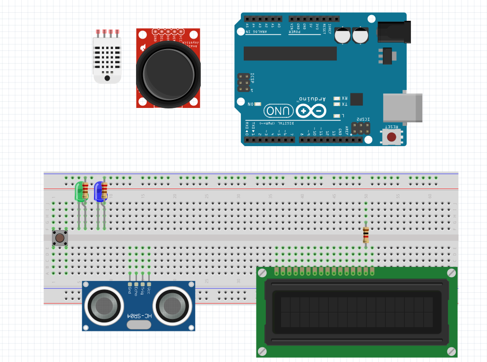
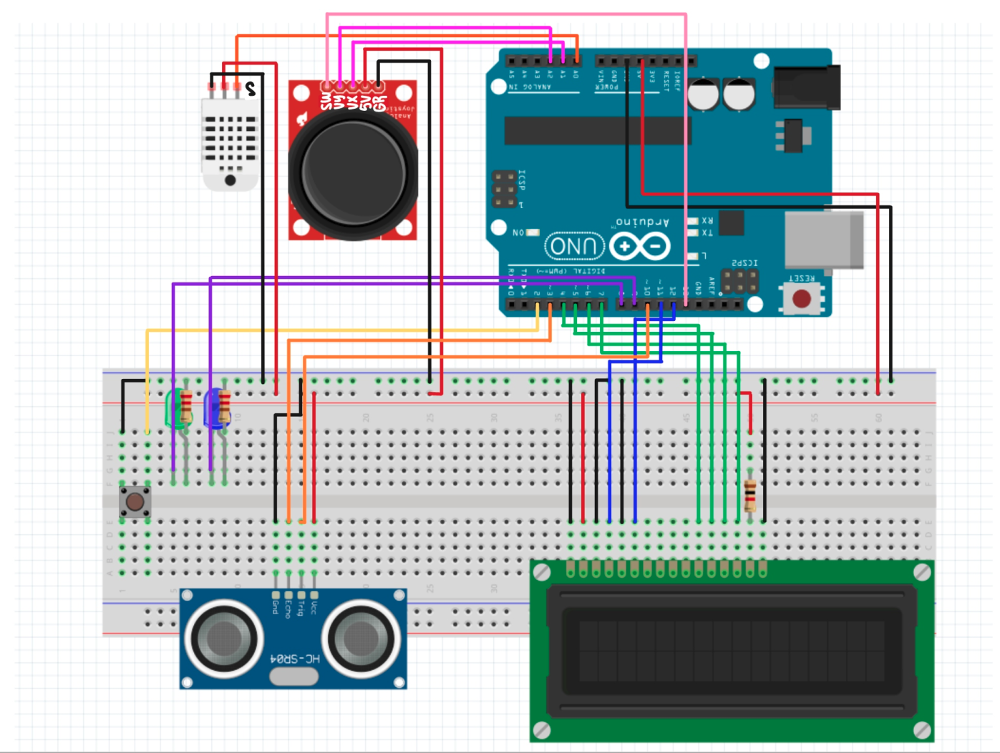
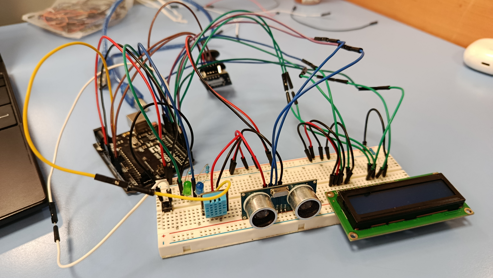
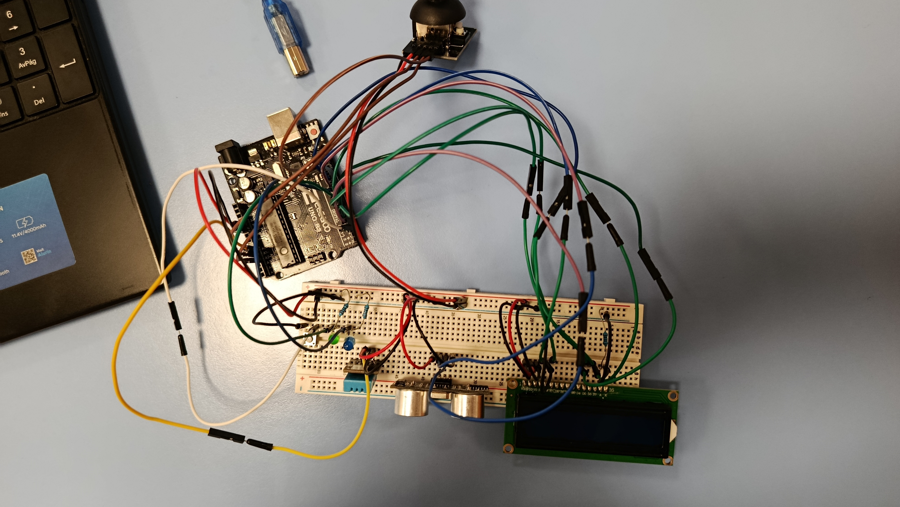

# PRÁCTICA 3 - MÁQUINA EXPENDEDORA
## Realizado por Manuel Martínez Arranz (m.martineza.2024@alumnos.urjc.es)

## COMPONENTES INICIALES



## ESQUEMÁTICO



> [!TIP]
> Tanto el pulsador como el joystick utilizan `INPUT_PULLUP` en sus pines de entrada. Esto permite activar las resistencias pull-up internas del microcontrolador, por lo que **no es necesario añadir resistencias externas** para estas entradas.
>
> Con esta configuración, el estado normal de la entrada es `HIGH` y, cuando se pulsa el botón o el joystick, la entrada pasa a `LOW`.

## FOTOS MONTAJE





## DESARROLLO

### 1. Threads

Se ha utilizado la librería `ThreadController.h` para ejecutar distintas tareas de forma periódica sin tener que concentrar toda la lógica en el `loop()`.

Se han creado cinco threads:

- **LED1 (`LedThread`):** controla el primer LED, que se utiliza para indicar el estado del sistema mediante diferentes modos (parpadeo, encendido y apagado). Tiene un intervalo de 1000 ms.
- **LED2 (`LedThread`):** controla el segundo LED, utilizado durante la preparación de la bebida. Tiene un intervalo de 20 ms para permitir un control más preciso de su intensidad mediante PWM.
- **DHT (`DHTThread`):** obtiene las medidas de temperatura y humedad del sensor DHT11. Tiene un intervalo de 1000 ms y se activa únicamente cuando es necesario mostrar información del sensor.
- **Ultrasonidos (`USThread`):** controla el sensor de distancia, utilizado para detectar la presencia de un cliente y para mostrar medidas durante la administración. Tiene un intervalo de 1000 ms.
- **Contador (`CounterThread`):** se encarga de actualizar el contador mostrado en la pantalla durante el modo de administración. Tiene un intervalo de 1000 ms.

Todos estos threads se añaden a un `ThreadController`, que se ejecuta continuamente mediante `controller.run()` dentro del `loop()` principal.

> [!IMPORTANT]
> Los threads utilizados no representan núcleos de ejecución independientes. Se trata de una planificación cooperativa de tareas: `controller.run()` comprueba qué threads están habilitados y cuáles deben ejecutarse según su intervalo.

Se ha utilizado este recurso para separar las tareas periódicas de la lógica principal del programa. De esta forma, por ejemplo, el LED puede seguir parpadeando mientras el sistema gestiona el menú o consulta los sensores, sin necesidad de utilizar esperas bloqueantes.

Además, los threads disponen de un atributo `enabled` que permite activar o desactivar su ejecución según el estado del sistema. Así se evita ejecutar tareas que no son necesarias en cada momento.

### 2. Interrupciones

Se ha utilizado una interrupción externa para detectar los cambios de estado del **botón** conectado al **pin 2**. Mediante `attachInterrupt()` se configura la interrupción para que se active tanto cuando el botón se pulsa como cuando se suelta (`CHANGE`):

```cpp
attachInterrupt(
    digitalPinToInterrupt(pin),
    buttonISR,
    CHANGE
);
```

> [!NOTE]
> Se ha elegido `CHANGE` en lugar de `RISING` o `FALLING` porque interesa detectar tanto el momento de pulsación como el de liberación. De esta manera, se puede calcular cuánto tiempo ha permanecido presionado el botón.

Cuando se produce una interrupción, se ejecuta la función `buttonISR()`, que únicamente modifica una variable global declarada como `volatile`:

```cpp
volatile bool buttonFlag = false;

void buttonISR() {
    buttonFlag = true;
}
```

> [!IMPORTANT]
> La variable `buttonFlag` se declara como `volatile` porque se comparte entre la interrupción y el programa principal. Así se evita que el compilador dé por hecho que su valor permanece inalterado entre lecturas.
> 
> La función de interrupción (`ISR`) debe ser lo más breve posible. Por eso, únicamente modifica `buttonFlag`, dejando las operaciones que requieren más procesamiento para el `loop()`.
>
> De esta forma, se evita realizar operaciones innecesarias dentro de la interrupción.

La interrupción no realiza directamente la lectura ni el procesamiento de la pulsación. Simplemente establece una bandera para avisar al programa principal de que ha ocurrido un cambio. Posteriormente, `buttonDuration()` comprueba esa bandera y realiza el resto de operaciones.

Para evitar los rebotes mecánicos del pulsador, se implementa un antirrebote por software de **50 ms**. Una vez transcurrido ese tiempo, se comprueba el estado real del pin mediante `digitalRead()` y se determina si el botón se ha pulsado o soltado.

Al detectar la pulsación se almacena el instante inicial (`pressStart`) y, al detectar la liberación, se calcula la duración de la pulsación. Esto permite diferenciar entre pulsaciones cortas y largas para ejecutar distintas acciones, como acceder al modo de administración.

### 3. Watchdog

Se ha utilizado el watchdog del microcontrolador mediante la librería `avr/wdt.h`. Se configura para generar un reinicio si el programa permanece más de 8 segundos sin actualizarlo:

```cpp
wdt_disable();
wdt_enable(WDTO_8S);
```

Posteriormente, se ejecuta `wdt_reset()` al principio de cada iteración del `loop()`.

De esta forma, mientras el programa siga funcionando correctamente, el watchdog se reinicia continuamente. Si se produce un bloqueo que impide continuar ejecutando el bucle principal, el watchdog termina provocando un reinicio del microcontrolador.

> [!IMPORTANT]
> El watchdog actúa como mecanismo de seguridad ante bloqueos inesperados. No evita que se produzcan errores, pero permite recuperar el funcionamiento del sistema mediante un reinicio automático si el programa deja de ejecutarse correctamente.

### 4. Máquina de estados

El funcionamiento general se organiza mediante distintos niveles de estados:

- **Modo principal (`Mode`):** distingue entre ARRANQUE, SERVICIO y ADMIN.
- **Submodo (`SubMode`):** controla las distintas fases del servicio: ESPERANDO, TEMPERATURA, PRODUCTOS, PREPARACION, PWM y RETIRADA.
- **Submodo de administración (`SubModeAdmin`):** permite navegar entre las opciones MENU, HUMEDAD, DISTANCIA, CONTADOR y PRECIOS.

> [!TIP]
> Separar el modo principal de los submodos permite organizar el funcionamiento sin tener que crear un único listado enorme de estados. Por ejemplo, SERVICIO puede tener sus propias fases de funcionamiento y ADMIN puede gestionar su propio menú de opciones.

También se utiliza `EditorPrecios` para diferenciar entre mostrar los productos y editar sus precios.

Esta organización permite controlar qué acciones deben ejecutarse en cada momento y qué threads deben estar activos.

### 5. Gestión de tiempos (`millis()`)

Para controlar las diferentes duraciones de tiempo se utilizan diferencias con `millis()` en lugar de esperas bloqueantes mediante `delay()`.

> [!IMPORTANT]
> No se utiliza `delay()` para gestionar las esperas del servicio. Esto evita detener el `loop()` durante varios segundos y permite que `controller.run()` siga ejecutándose, manteniendo activas las tareas periódicas.

Algunos ejemplos son:

- Se muestran los datos del sensor DHT11 durante 5 segundos cuando se detecta un cliente.
- La preparación de la bebida tiene una duración aleatoria de entre 4 y 8 segundos.
- Una vez finalizada la preparación, se muestran las instrucciones para retirar la bebida durante 3 segundos.

El tiempo transcurrido se calcula comparando el valor actual de `millis()` con el instante en el que comenzó cada operación:

```cpp
if (millis() - inicio >= waiting) {
    // Finalizar operación
}
```

Se ha elegido este método porque permite controlar los tiempos sin detener la ejecución del programa. Mientras transcurre una operación, el resto de tareas pueden seguir ejecutándose, incluyendo la actualización de los LEDs, la lectura de sensores y la gestión de entradas.

> [!NOTE]
> La duración de la preparación se genera aleatoriamente mediante `random(4000,8001)`, por lo que puede variar entre 4000 y 8000 ms. Esto permite simular que cada bebida necesita un tiempo de preparación diferente.

### 6. Joystick

Para evitar que el joystick registre varios movimientos mientras permanece desplazado, se utilizan variables de reposo (`joystick_reposo` y `joystick_reposo_x`). De esta manera, es necesario devolver el joystick a su posición central antes de registrar un nuevo movimiento.

> [!NOTE]
> Se utilizan dos variables de reposo para los ejes X e Y porque cada eje tiene su propio movimiento independiente. Así se evita que un movimiento en una dirección interfiera con la detección del otro.

También se utiliza `pulsadoAntes` para detectar el flanco de pulsación del joystick y evitar registrar múltiples selecciones mientras se mantiene presionado.

> [!IMPORTANT]
> La selección del menú se realiza detectando una nueva pulsación y no simplemente comprobando si el joystick permanece presionado. Esto evita que una pulsación mantenida provoque varias selecciones consecutivas.

## RESULTADO

Se ha conseguido implementar correctamente la máquina expendedora, con todas las funciones que se pedían. Ahora podemos seleccionar productos, consultar información y acceder al modo administrador para gestionar la máquina :)
